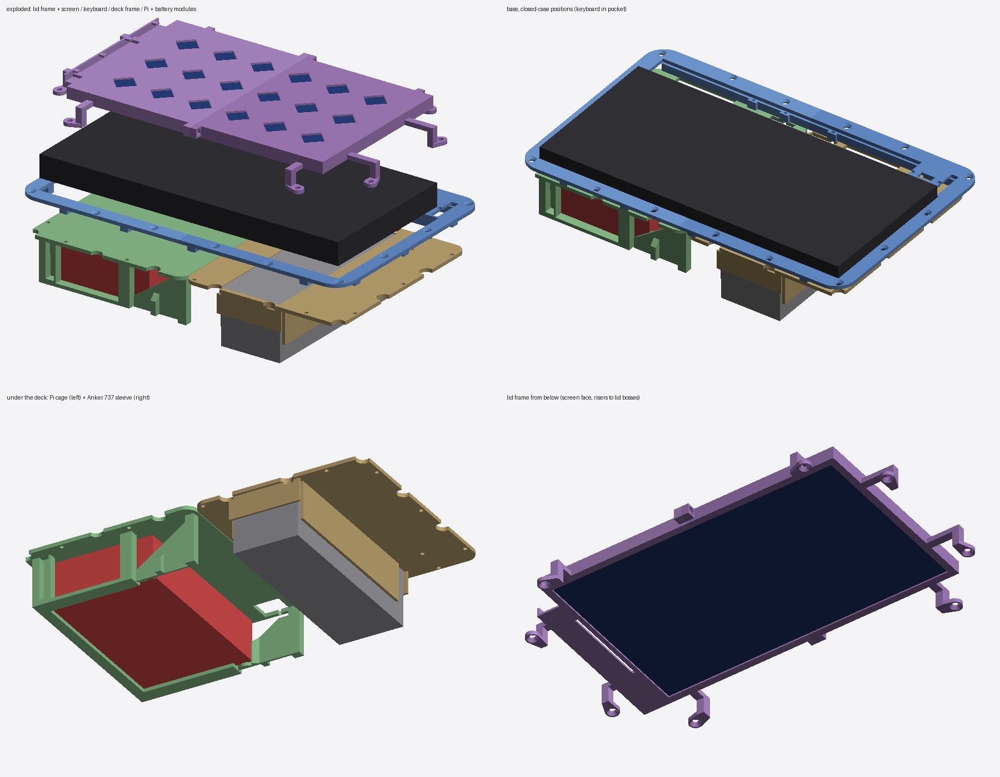

# Pi Box

A Raspberry Pi 5 laptop built into a **Nanuk 909** hard case. All the parts are 3D-printed:

- a 10.1" HMTECH touchscreen in the lid
- an SR mini keyboard in a pocket on the deck
- a GeeekPi DeskPi Lite Pi5 and an Anker 737 power bank underneath the keyboard
- a cable trough along the hinge side



## Files

| Path | What |
|---|---|
| `parts/` | The six printable parts as STL and 3MF, each already in print orientation and ≤ 256 × 256 mm. Also `fit_report.txt`. |
| `pibox_case.py` | Parametric source for the full case. Re-run it after changing the measurements at the top. |
| `undercarriage_v2.py` / `.stl` / `.3mf` | Stand-alone half-plate DeskPi holder. Its cage is reused in `parts/pi_module`. |
| `pi undercairrage box.3mf` | The original v1 undercarriage, kept for reference. |
| `viewer/index.html` | Interactive 3D viewer for every model. Open it in a browser. |
| `BUILD_NOTES.md` | Print settings, hardware list, assembly order, and the measurements to check. |
| `pibox_case_sections.png` | Closed-case cross-sections. |

## Rebuild

```bash
pip install numpy trimesh manifold3d
python pibox_case.py
```

```bash
python undercarriage_v2.py
```

## Status

Designed from Nanuk's bezel drawings and the parts' listing dimensions (the screen is measured). Nothing has been test-fitted yet. `BUILD_NOTES.md` lists the assumed values to measure before printing.

The Nanuk 909 bezel plate drawings (PDF/DXF) are Plasticase's property and are not included. The scripts already contain the hole coordinates they need.
